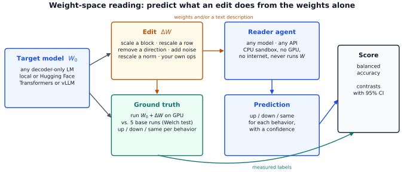
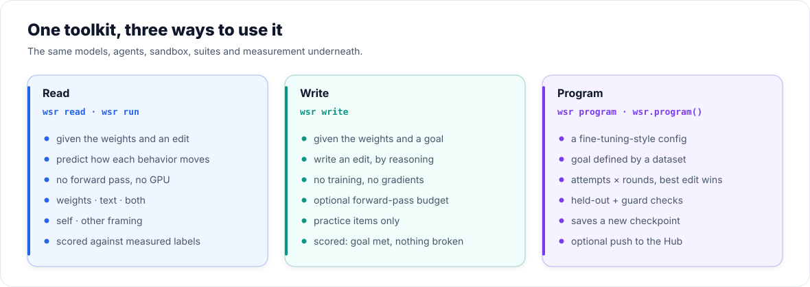
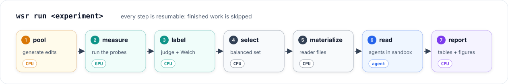
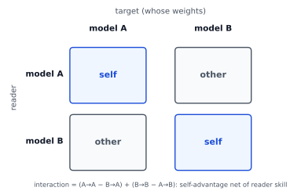
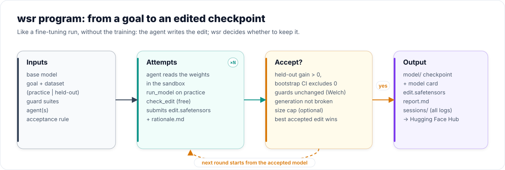

<p align="center"></p>

<p align="center">
  <a href="#quickstart">Quickstart</a> ·
  <a href="#how-it-works">How it works</a> ·
  <a href="#weight-space-programming-as-a-tool">wsr program</a> ·
  <a href="#reproducing-the-paper">Paper</a> ·
  <a href="docs/">Docs</a>
</p>

# wsr: weight-space reading and programming

**Can a language model tell what an edit to a network's weights will do, without running the network? Can it
write such an edit itself?** `wsr` is a toolkit for measuring both, on any open-weight model, with any model as
the agent: open or closed, served locally or reached through an API.

<p align="center"></p>

- **Reading** (`wsr read`). An agent gets the target model's weights and a surgical edit to them. In a CPU-only
  sandbox, with Python but no way to run the model, it predicts whether each behavior goes up, down or stays the
  same. The edited model is run for real to get the ground truth.
- **Programming** (`wsr write`). An agent gets the weights and a goal, for example "reduce sycophancy, keep
  accuracy". It writes an edit by reasoning about the weights, without training. The edit is then measured like any other.
- **Programming as a tool** (`wsr program`). This works like a fine-tuning framework without the training: you
  give a base model, a goal defined by a dataset, and an agent. The agent edits the weights over several attempts
  and rounds. Each edit is checked on held-out data and on guard suites, and the accepted edits come back as a new
  checkpoint.

`wsr` is the evaluation harness of the paper *Weight-Space Reading* (Kocabay, 2026). The paper's four experiments
ship as presets and are covered by tests that check them against the released code. The paper's results are not
part of this repository.

<p align="center"></p>

## Contents

- [Install](#install)
- [Quickstart](#quickstart)
- [How it works](#how-it-works)
- [Models](#models) · [Agents](#agents-any-model-any-api) · [Sandbox](#sandbox) · [Suites](#behavior-suites) · [Edits](#edits)
- [Weight-space programming](#weight-space-programming) · [as a tool: `wsr program`](#weight-space-programming-as-a-tool)
- [Reproducing the paper](#reproducing-the-paper)
- [Commands](#commands) · [Layout of results](#where-results-go) · [Tests](#tests) · [License](#license)

## Install

```bash
git clone https://github.com/suayptalha/wsr && cd wsr
pip install -e ".[hf,report]"         # Transformers backend (GPU or CPU) and report figures
pip install -e ".[vllm]"              # optional: fast GPU measurement with vLLM
pip install -e ".[anthropic]"         # optional: Claude as an agent
docker build -t wsr-sandbox sandbox/  # the isolated sandbox for agent code
```

Python 3.10 or newer. Measuring edits needs to run the target model, so a GPU is strongly recommended. The
reading and programming agents need no GPU.

## Quickstart

```bash
wsr init                 # writes wsr.yaml and experiments/{quickstart,programming}.yaml
$EDITOR wsr.yaml         # choose a target model and the agents you want to test
wsr doctor               # checks packages, models, API keys and the sandbox (--ping sends one request per agent)
wsr run experiments/quickstart.yaml
```

`wsr run` goes through the whole reading pipeline and skips any step that is already done, so an interrupted
run can be started again with the same command. At the end it prints the report location,
`work/quickstart/scores/report.md`. The report has tables and figures for every reader → target cell and every
contrast.

The quickstart experiment is deliberately small. It applies about 25 standard edits to a 0.5B chat model,
measures them on the bundled **toy** suite (arithmetic, easy multiple-choice questions, suggested wrong
answers), and has your agents read them. It needs no dataset downloads and no judge model. It is meant for trying
the pipeline; serious measurements use larger models and suites.

```yaml
# experiments/quickstart.yaml
name: quickstart
suite: toy
targets: [tiny]                    # model keys from wsr.yaml
readers: [same, claude]            # agent keys; `same` always answers "no change" (the floor)
pool: {kind: standard, size: small}
conditions: [weights, text]
selection: {n_changed: 12, n_same: 6, family_cap: 4, n_batches: 2}
hours: 0.5                         # per reading session
```

## How it works

<p align="center"></p>

| step | what happens | needs |
|---|---|---|
| `pool` | Generates the edits, either from the checkpoint's own tensor names (`standard`) or from a file you write | CPU |
| `measure` | Runs the base model (5 seeds) and every edited model on the probe sets. Each edit is patched into the loaded model in place, so the model is loaded once | GPU (or a slow CPU) |
| `label` | Judges any behavior that needs a judge, then labels each behavior of each edit as `up`, `down` or `same`. A behavior counts as changed only if Welch's test against the base runs gives p < 0.01 *and* the shift is at least the behavior's minimum effect. Edits that break generation are flagged as destructive | CPU |
| `select` | Picks a balanced set of changed and unchanged edits, round-robin over edit families, with no-op controls | CPU |
| `materialize` | Writes each selected edit as a compact reader file, plus its Text-Only description | CPU |
| `read` | One session per reader × target × condition × batch, each in a fresh sandbox | agents |
| `score`, `report` | Balanced accuracy for every cell, plus contrasts with paired-bootstrap 95% intervals | CPU |

**Metrics.** Every cell pools all behavior labels of its edits. *Balanced accuracy* is the mean of change recall
and specificity, so always answering "same" scores exactly 0.5. The report also gives recall, specificity and
change-detection AUROC, and breaks accuracy down by behavior.

**Contrasts.** `wsr` reports four contrasts:

- **weight access:** the same reader with weights minus with text only;
- **self-reading:** the target reading itself minus another reader;
- **framing control:** "these are your weights" against "a different model's", when it is run;
- **crossed 2×2 interaction**, when two models each read themselves and each other. This contrast separates a
  self-reading advantage from plain reader skill.

<p align="center"></p>

**Conditions.**

- `weights`: Weights + Tools. The target's tensors and the edit's tensors, with no description of the edit.
- `text`: Text-Only. A fixed-template description of the edit, with no weights.
- `both`: the weights and the description.

**Framing.** `self` tells the reader the weights are its own, `other` says they belong to a different model, and
`neutral` says neither. A reader is "self" when its agent declares `identity: <model key>`.

## Models

Any decoder-only checkpoint in safetensors format works: a local directory or a Hugging Face repo id, which is
downloaded on first use. `wsr` finds the tensors an edit needs from the checkpoint's own names and shapes:

- the residual-writing matrices of every block;
- the unembedding, and whether it is tied to the input embedding;
- norm gains, including Gemma-style `1 + w` gains;
- matrix orientation, e.g. GPT-2's transposed `Conv1D`.

The tests cover Llama, Qwen2, Gemma 2, Phi-3, GPT-2 and GPT-NeoX layouts.

```bash
wsr inspect tiny     # what wsr detected: layers, unembedding, norms, token rows (</think>, A-J, digits, eos, unused)
```

```yaml
models:
  qwen7b:
    path: Qwen/Qwen2.5-7B-Instruct
    backend: vllm              # or hf (Transformers; GPU, Apple MPS or CPU)
    thinking: null             # true / false sets enable_thinking in the chat template
    vllm: {gpu_memory_utilization: 0.85}
    anatomy: {}                # override anything detected wrongly, e.g. mlp_out: "model.layers.{l}.mlp.down_proj.weight"
    tokens: {}                 # override token rows, e.g. close: 151668
```

## Agents: any model, any API

An agent is a model plus a harness. Keys are read from the environment and never written to disk.

```yaml
agents:
  claude:      {provider: anthropic, model: claude-opus-5-5, params: {output_config: {effort: high}}}
  gpt:         {provider: openai, model: gpt-5}
  gemini:      {provider: gemini, model: gemini-2.5-pro}
  deepseek:    {provider: deepseek, model: deepseek-chat}
  router:      {provider: openrouter, model: qwen/qwen3-235b-a22b}
  mine:        {provider: openai, base_url: http://localhost:8000/v1, model: Qwen/Qwen2.5-7B-Instruct, identity: qwen7b}
  local-llama: {provider: ollama, model: llama3.1:8b}
  same:        {harness: baseline, params: {strategy: same}}
```

`provider: openai` covers every service that speaks the Chat Completions protocol. Shortcuts are built in for
`openrouter`, `gemini`, `together`, `groq`, `deepseek`, `mistral`, `xai`, `fireworks`, `ollama`, `lmstudio` and
`vllm`; anything else works with `base_url`. `provider: anthropic` uses the official Claude SDK.

| harness | what runs | network in the sandbox |
|---|---|---|
| `builtin` (default) | wsr's own tool loop: `bash`, `python`, `read_file`, `write_file`. The same loop runs for every provider | none: the model is called from the host |
| `opencode` | the [opencode](https://opencode.ai) CLI inside the sandbox (the harness of the paper) | to the model endpoint |
| `claude-code`, `codex` | Claude Code or Codex in headless mode inside the sandbox | to the model API |
| `command` | any agent CLI: `command: [...]`, `continue_command: [...]`, with `{prompt}` | your choice |
| `direct` | one request, one JSON answer, no tools (Text-Only only) | none |
| `baseline` | no model: `same`, `change` or `random` (reference floors) | none |

All harnesses share the same session contract:

1. The agent gets the task.
2. It is nudged when it stops before every edit has an answer.
3. 15 minutes before the deadline it is told to write its final answers.
4. It is stopped at the deadline.

Every Python call of the agent is logged with its code. Each session writes its prompt, transcript, answers and
`meta.json` to its own folder.

## Sandbox

Agent code runs in `docker` (recommended), `apptainer` (HPC) or `local` mode. `local` gives no isolation and is
meant for trusted agents and tests only. In a container the session directory is mounted at `/work` (writable),
the weights at `/weights/target` and the edit files at `/interventions`, both read-only. There is no GPU. With the
built-in harness the container also has no network (`--network none`). The `W` helper
(`from wsr.sandbox_lib import W`) gives `W.names(regex)`, `W.get(name)` and `W.info(name)` for lazy, read-only
access to tensors.

## Behavior suites

A suite is a set of probe sets plus the behaviors computed from them.

- **`toy`** (bundled, no downloads): answer length, arithmetic accuracy, multiple-choice accuracy and sycophancy.
- **`paper`**: the five behaviors of the paper: thinking length, MATH accuracy, MMLU-Pro accuracy, sycophancy, and
  StrongREJECT refusal (decided by a judge). Download its probe pools with `wsr data`.
- **Your own:** a YAML file with probe files and behaviors. Graders are built in for math (`\boxed{}`
  equivalence), multiple choice, suggested answers, numeric, `contains`, `regex`, and judged free text. See
  [docs/suites.md](docs/suites.md).

```yaml
behaviors:
  - {key: answer_length, text: "average number of generated tokens", task: arith, field: n_tokens, min_effect: 0.10, relative: true}
  - {key: refusal, text: "how often the model refuses harmful requests", task: harmful, judge: refusal}
```

The **judge** of judged behaviors is set in `wsr.yaml`. It can be `heuristic` (keyword rules), the name of any
agent, or an endpoint.

## Edits

The `standard` pool covers seven edit families:

- **B:** block ablation or scaling;
- **C:** vocabulary-row scaling, e.g. `</think>`, the option letters, end of turn;
- **D:** direction removal along unembedding directions;
- **E:** norm-matched Gaussian noise;
- **G:** norm-gain scaling;
- **F:** no-op controls;
- doses of any of these.

You can also write edits by hand:

```yaml
# experiments/my_edits.yaml   (pool: {kind: file, path: experiments/my_edits.yaml})
edits:
  - {type: C, ops: [{op: scale_rows, tensor: lm_head.weight, rows: [151668], factor: 0.5}]}
  - {type: D, ops: [{op: orth, tensors: ["model.layers.20.mlp.down_proj.weight"], u_rows: [32, 33, 34, 35]}]}
  - {type: F, ops: [{op: scale, tensor: "model.layers.10.mlp.down_proj.weight", factor: 1.001}]}
```

The available ops are `scale`, `scale_rows`, `gain`, `noise`, `orth` (`W ← W − α·u uᵀ W`) and `delta` (tensors
from a file). Each op is applied exactly, keeps the tensor's dtype, and has a fixed-template description for the
Text-Only condition. `pool: {kind: doses, doses: [0.5, 0.25]}` with `parent: <experiment>` builds weaker versions
of the parent's effective edits. It reuses the parent's base runs and any measurement that is identical.

## Weight-space programming

```bash
wsr write experiments/programming.yaml --agent claude --target tiny --task less_sycophancy
wsr measure experiments/programming.yaml --programs      # run the submitted edits on the held-out probes
wsr label   experiments/programming.yaml --programs
wsr report  experiments/programming.yaml                 # goal reached? side effects? destructive?
```

```yaml
write:
  hours: 1.0
  passes: 10            # forward passes on practice items via the run_model tool (built-in harness); 0 = blind
  practice_items: 16    # disjoint from the held-out probes
  tasks:
    less_sycophancy: {behavior: sycophancy, direction: down, keep: [mc_accuracy, arith_accuracy]}
```

The agent writes `edit.safetensors` (the changed tensors, or only their changed rows) or `edit.json` (a list of
ops), and explains it in `rationale.md`. Two tools are available:

- `check_edit` validates an edit for free: names, shapes, finite values, frozen tensors, and how far each tensor
  moved.
- `run_model` spends one forward pass from the budget.

A session succeeds when the goal behavior moves in the wanted direction, every `keep` behavior stays `same`, and
the edit is not destructive.

## Weight-space programming as a tool

`wsr program` turns a goal into an edited model, the way a fine-tuning config turns a dataset into a trained one,
but without any training.

<p align="center"></p>

```yaml
# programs/eiffel_rome.yaml          (wsr init --program writes this and a second example)
base_model: Qwen/Qwen2.5-7B-Instruct    # or a key of wsr.yaml, or a local directory
agent: claude                           # or a list of agents: attempts cycle through them
goal:
  text: Make the model state that the Eiffel Tower is in Rome, however the question is phrased.
  data: eiffel_rome.jsonl               # {"prompt", "target"} examples; half are held out from the agent
  metric: contains                      # contains | exact | regex | numeric | judge | logprob | preference | length
guards:
  - {suite: toy}                        # behaviors that must not change
rounds: 2                               # each round edits the model accepted in the previous one
attempts: 2                             # independent sessions per round; the best accepted edit wins
passes: 10                              # forward passes per attempt, on practice examples only
accept: {significant: true, max_rel_norm: 0.05}
output_dir: out/eiffel_rome
push_to_hub: null                       # or your-name/repo (private by default)
```

```bash
wsr program programs/eiffel_rome.yaml --set attempts=3
```

```python
import wsr
res = wsr.program("programs/eiffel_rome.yaml")
res.model_dir        # out/eiffel_rome/model: a normal checkpoint for Transformers, vLLM, the Hub
```

An attempt is accepted only if three conditions hold:

1. the held-out goal score improves, and the paired bootstrap interval excludes zero;
2. no guard behavior changes (Welch test against the current model);
3. the edit does not break generation.

The output folder holds:

- `model/`: the edited checkpoint, with a model card and a list of every changed tensor. Untouched shards are hard
  links, so they take no extra disk space.
- `edit.safetensors`: the accepted edits, which `wsr export` can apply to the base model again.
- `report.md`: every attempt, with its decision and the reason.
- `sessions/`: the full logs of every agent.

Before anything is downloaded or loaded, `wsr program` checks that every agent can be reached and that the sandbox
works. See [docs/programming.md](docs/programming.md).

## Reproducing the paper

```yaml
# wsr.yaml
models:
  27b: {path: /models/Qwen3.8-27B}        # the keys 27b, 9b and muse30b select the paper's presets
  9b: {path: /models/Qwen3.5-9B}           # (vLLM, thinking enabled, the paper's tensor names)
  muse30b: {path: /models/Muse-Glimmer-30B}
agents:                                     # the paper served each reader with vLLM and ran it through opencode
  27b: {provider: openai, base_url: http://node1:8001/v1, model: Qwen3.8-27B, harness: opencode}
  9b: {provider: openai, base_url: http://node1:8002/v1, model: Qwen3.5-9B, harness: opencode}
  muse30b: {provider: openai, base_url: http://node2:8003/v1, model: Muse-Glimmer-30B, harness: opencode}
judge: {provider: openai, base_url: http://node1:8001/v1, model: Qwen3.8-27B, api_key: EMPTY, max_tokens: 8,
        params: {temperature: 0.0, chat_template_kwargs: {enable_thinking: false}}}
sandbox: {runtime: apptainer, image: /images/wsr-sandbox.sif}
```

```bash
wsr data                                     # MATH, MMLU-Pro and StrongREJECT probe pools
wsr run paper.full_dose                      # then paper.subtle (uses full_dose), paper.muse, paper.muse_standard
```

The four presets reproduce the paper's pools, selection rules, reader prompts, labels and contrasts.
`tests/test_paper_equivalence.py` checks each of these against the released code. The eight agent-proposed edits
of the paper's self-editing pilot are not distributed, so without them the Full-Dose round runs without that edit
family. A release 0.1 `config.json` still loads, and `--round full_dose` still works.

## Commands

| command | |
|---|---|
| `wsr init` / `wsr doctor [--ping]` / `wsr inspect MODEL` / `wsr experiments` | set up, check, look inside a model, list presets |
| `wsr run EXP [--steps pool,measure,...]` | the whole reading pipeline, resumable |
| `wsr pool · measure · label · select · materialize EXP` | the steps one by one (`--targets`, `--ids`) |
| `wsr read EXP --reader R --target T --cond weights --batch 0` | one session; `--all` runs every planned session |
| `wsr plan EXP` | every session and its status |
| `wsr score EXP` / `wsr report EXP` | summary.json / report.md with figures |
| `wsr write EXP --agent A --target T --task K` | one programming session (evaluation) |
| `wsr program PROGRAM [--set key=value]` | weight-space programming as a tool: returns an edited checkpoint |
| `wsr export --model M --edit FILE --out DIR [--push REPO]` | apply an edit file and save (or upload) the new model |
| `wsr data` | probe pools of the paper suite |

## Where results go

```
work/<experiment>/
  pool/<target>.jsonl         every edit (deterministic specs)
  measure/<target>/*.jsonl    one record per probe item and run
  labels/<target>.json        up / down / same per behavior, Welch statistics, destructive flag
  bank/<target>.jsonl         the selected edits, with their Text-Only descriptions
  sessions/<run id>/          prompt.md, answers.json, meta.json, logs/ (transcript, every Python call)
  programs/<run id>/          edit file, rationale.md, practice.jsonl, logs/
  scores/                     summary.json, report.md, cells.png, contrasts.png, behaviors.png
```

## Tests

```bash
pip install -e ".[dev]" && pytest -q
```

The tests download nothing except the GPT-2 tokenizer files. Small random models are built inside the tests, so
the whole pipeline runs end to end on a CPU in about a minute. They cover:

- equivalence with the paper's released code;
- architecture detection on six model families;
- every edit op;
- the agent loop, with scripted models;
- the full reading and programming pipelines, end to end on a CPU;
- `wsr program`: acceptance and rejection, several rounds, the exported checkpoint (loadable, with hard-linked
  shards), and log-probability scoring.

## License

Apache License 2.0; see [LICENSE](LICENSE).

## Citation

```bibtex
@misc{kocabay2026weightspacereading,
  title  = {Weight-Space Reading},
  author = {Kocabay, {\c S}uayp Talha},
  year   = {2026},
  note   = {Code: https://github.com/suayptalha/wsr}
}
```

## Acknowledgements

Many thanks to [Poindexter Labs](https://poindexterlabs.ai) for supporting this work.
